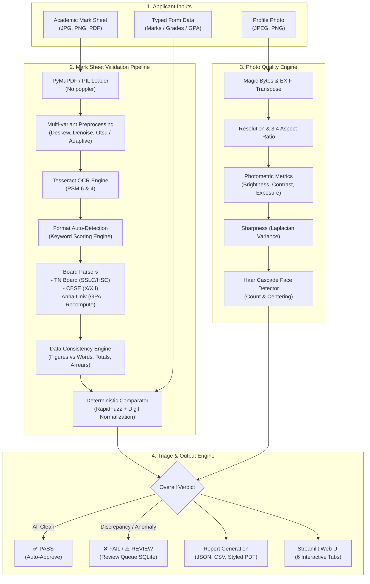

# MH26-01 · Smart Admission Document Validation
> **Maatram Community Theme · Software Track · Hackathon Prototype**  
> *Deterministic, 100% Classical Computer Vision & OCR — Zero Generative AI / LLMs*

---

## 📌 Executive Summary

During college admissions, thousands of applicants submit academic mark sheets and passport photos while manually typing their marks into web forms. Human document verification is tedious, error-prone, and a major bottleneck.

**Smart Admission Document Validation** is an automated, end-to-end verification pipeline that:
1. **Validates Academic Mark Sheets**: Ingests JPG, PNG, and PDF (via PyMuPDF, no poppler) mark sheets, auto-detects board format (Tamil Nadu State Board, CBSE, or Anna University), runs OCR with multi-variant adaptive preprocessing, extracts subject marks/grades with regex + RapidFuzz aliases, checks data consistency (e.g., recomputed totals and GPA), and cross-checks every field against applicant-typed data.
2. **Validates Profile Photos**: Validates magic bytes, file size, dimensions, 3:4 aspect ratio, EXIF orientation, mean brightness, contrast (std dev), blur/sharpness (variance of Laplacian), over/under-exposure histograms, and face centering/count via Haar Cascade.
3. **Automates Triage via Exception Queue**: Flags discrepancies (`MISMATCH`, `MISSING`, `LOW_CONFIDENCE`, photo defects, figures-vs-words mismatch) into an SQLite audit queue with prioritized review (High / Medium / Low) and reviewer actions (Approve / Reject / Re-upload).
4. **Exports Compliance Reports**: Generates JSON, CSV, and publication-ready styled PDF reports.

---

## 🏛️ Architecture Pipeline



---

## 📋 Supported Formats

| Format | Detection Keywords | Extraction Strategy | Consistency Checks |
|---|---|---|---|
| **Tamil Nadu State Board**<br>*(SSLC Class 10 & HSC Class 12)* | `GOVERNMENT OF TAMIL NADU`, `DIRECTORATE OF GOVERNMENT EXAMINATIONS`, `SSLC`, `HIGHER SECONDARY` | 5 required SSLC subjects or HSC theory+practical+total per subject. Regex table parsing + RapidFuzz aliases. | Sum of marks = printed total; figures vs words check; marks in 0..100. |
| **CBSE**<br>*(Class 10 & Class 12)* | `CENTRAL BOARD OF SECONDARY EDUCATION`, `CBSE`, `SECONDARY SCHOOL EXAMINATION` | Subject code (041, 086, 087, 184, 085, etc.), subject title, marks in figures & words, positional grades (A1..E2). | Figures vs words cross-check; candidate number filtering; grade-confusion mapping. |
| **Anna University**<br>*(Semester Grade Sheet)* | `ANNA UNIVERSITY`, `SEMESTER`, `GRADE SHEET`, `COURSE CODE`, `GPA`, `CGPA` | Course codes (e.g., `MA3354`, `CS3351`), title, credits, letter grades (`O`, `A+`, `A`, `B+`, `B`, `C`, `U`, `RA`). | **GPA Recomputation**: $\text{GPA} = \frac{\sum (\text{credits} \times \text{grade\_points})}{\sum \text{credits}}$ matches printed GPA; Arrear detection (`U`/`RA`). |

---

## 🛡️ Hard Constraints & Zero-GenAI Guarantee

> **CRITICAL COMPLIANCE NOTICE**:  
> This system uses **strictly classical computer vision and deterministic rule engines**.  
> **NO Generative AI, LLMs, or Cloud AI APIs are used anywhere in the core validation pipeline.**

- **OCR**: Pytesseract (Tesseract v5 engine) with Line/Word bbox tokenization
- **PDF Extraction**: PyMuPDF (`fitz`) — 100% self-contained, **zero Poppler dependency**
- **Computer Vision**: OpenCV (`cv2`) & Pillow (`PIL`)
- **Fuzzy Matching**: RapidFuzz string metric tokenization
- **Face Detection**: OpenCV Haar Feature-based Cascade (`haarcascade_frontalface_default.xml`)
- **PDF Generation**: fpdf2 with pure programmatic styling and table layout

---

## 🚀 Quick Start (Windows 10/11 PowerShell)

### Automated Setup
Clone or navigate to the directory and run:
```powershell
# 1. Automated Virtual Environment & Dependency Installation
.\setup.ps1

# 2. Launch the Streamlit Interactive Application
.\run.ps1
```

### Manual Commands
```powershell
# Create virtual environment
python -m venv .venv
.\.venv\Scripts\Activate.ps1

# Install dependencies
pip install -r requirements.txt

# Generate synthetic dataset (96 mark sheets, procedural photos, ground truth)
python data_gen/generate.py

# Run test suite
python -m pytest tests/ -v

# Run evaluation benchmark
python evaluate.py

# Launch Streamlit app
streamlit run app.py
```

---

### Deploy to Streamlit Community Cloud

This project is a Streamlit app; deploy it with Streamlit Community Cloud rather than a Python serverless host such as Vercel.

1. Push the repository to GitHub.
2. In [Streamlit Community Cloud](https://share.streamlit.io/), choose **Create app** and connect the GitHub repository.
3. Select the `main` branch and set the app file path to `app.py` (repository root), then deploy.

Cloud installs Python dependencies from `requirements.txt` and system packages from `packages.txt`. The latter installs Tesseract OCR for mark-sheet validation.

## 🔍 Tesseract OCR Auto-Detection Hierarchy

On Windows, the application auto-detects Tesseract in this strict order:
1. `TESSERACT_CMD` environment variable
2. `shutil.which("tesseract")` (system `PATH`)
3. `C:\Program Files\Tesseract-OCR\tesseract.exe`
4. `C:\Program Files (x86)\Tesseract-OCR\tesseract.exe`
5. Fallback path configured in `config.yaml`

If Tesseract is not found, the app displays a clear guidance banner with an installation link while continuing to support photo validation, manual review, and analytics.

---

## 🖥️ Streamlit Multi-Tab Application Guide

| Tab | Feature | Description |
|---|---|---|
| **Tab 1: Validate Application** | Single App Validation | Upload mark sheet (JPG/PNG/PDF) and photo. Select or auto-detect format. View live comparison table with emoji statuses (`✅ Match`, `❌ Mismatch`, `⚠️ Low Confidence`), annotated mark sheet with colored bounding boxes, photo quality gauge meters, and download PDF/CSV/JSON reports. |
| **Tab 2: Batch Processing** | High-Throughput Batch | Run validation across synthetic applications with progress tracking, KPI cards, and CSV/JSON bulk export. |
| **Tab 3: Review Queue** | SQLite Exception Triage | Filter flagged applications by priority (`High`/`Medium`/`Low`) and status (`Pending`/`Approved`/`Rejected`/`Re-upload Requested`). Review side-by-side details, approve or reject with comments, and view complete audit trail. |
| **Tab 4: Analytics Dashboard** | Real-time Charts | Plotly charts showing pass/fail/review distributions, format breakdowns, anomaly breakdown, and photo quality trends. |
| **Tab 5: Accuracy Evaluation** | Benchmark Suite | View benchmark accuracy results: format detection confusion matrix, field extraction accuracy by format, mismatch precision/recall/F1, and photo classification accuracy. |
| **Tab 6: Settings** | Config Management | Live tuning of photo validation thresholds (dimensions, brightness, contrast, sharpness, exposure limits) with instant persistence to `config.yaml`. |

---

## 🧪 Test Suite

All 26 unit and integration tests run in under 15 seconds:

```powershell
python -m pytest tests/ -v
```

- `tests/test_comparator.py`: Digit confusion normalization, grade normalization, words-to-number parsing, numeric/grade/identity comparison.
- `tests/test_detector.py`: Format detection scoring for TN Board, CBSE, Anna Univ, and manual overrides.
- `tests/test_parsers.py`: Board-specific table parsing and subject alias mapping.
- `tests/test_anna_univ_gpa.py`: Deterministic GPA calculation, arrear flagging, course code normalization.
- `tests/test_photo.py`: Magic bytes, dimension check, aspect ratio, blur detection, face centering.
- `tests/test_e2e.py`: Complete pipeline integration test across TN Board, CBSE, and Anna University with PDF report generation and SQLite review queue.

---

## 📁 Repository Structure

```text
MTM- Smart Admission Document Validation/
├── config.yaml               # Validation thresholds, board profiles, aliases, weights
├── rules.py                  # Singleton configuration manager and accessors
├── reporting.py              # Table generation, JSON/CSV export, styled PDF via fpdf2
├── review_queue.py           # SQLite exception triage queue with audit trail
├── evaluate.py               # Benchmark runner across synthetic ground truth
├── app.py                    # Streamlit interactive application (6 tabs)
├── setup.ps1                 # Automated Windows PowerShell environment installer
├── run.ps1                   # Automated Streamlit launcher
├── requirements.txt          # Pinned Python package dependencies
├── validators/
│   ├── comparator.py         # Deterministic field comparison (RapidFuzz, digit fix)
│   ├── marksheet.py          # Preprocessing, OCR dispatch, bbox annotations
│   ├── photo.py              # Photometric checks, Laplacian blur, Haar cascade face
│   ├── tesseract_utils.py    # Auto-detection hierarchy, line/word tokenization
│   └── formats/
│       ├── base.py           # Base normalization, number-words mapping, aliases
│       ├── detector.py       # Keyword scoring engine for format detection
│       ├── tn_board.py       # Tamil Nadu SSLC & HSC parser
│       ├── cbse.py           # CBSE Class 10 & 12 parser
│       └── anna_univ.py      # Anna University semester grade sheet parser
├── data_gen/
│   └── generate.py           # Synthetic generator: 96 mark sheets, photos, ground truth
└── tests/
    ├── test_comparator.py    # Comparator unit tests
    ├── test_detector.py      # Detector unit tests
    ├── test_parsers.py       # Board parser unit tests
    ├── test_anna_univ_gpa.py # GPA recomputation & arrear unit tests
    ├── test_photo.py         # Photo quality unit tests
    └── test_e2e.py           # End-to-end integration test suite
```

